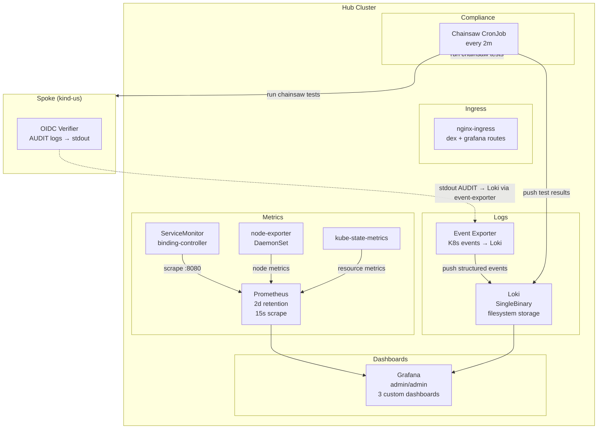
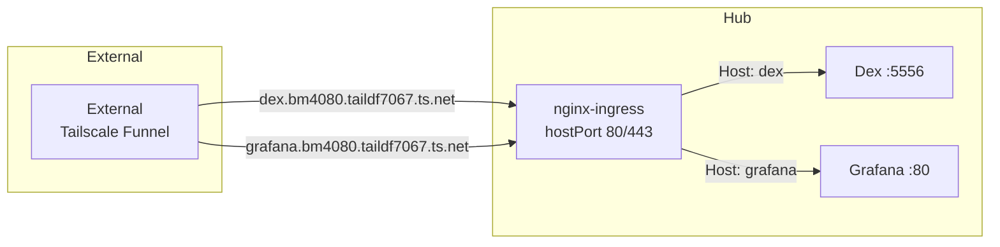
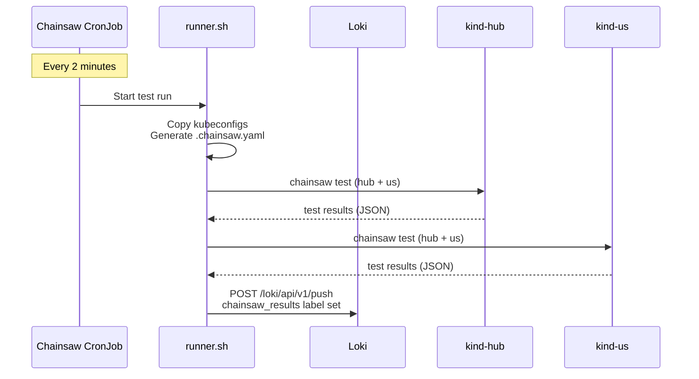
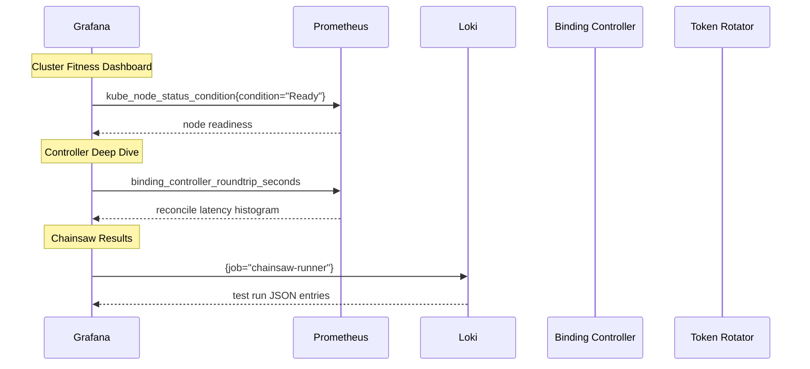

# Phase 8 — Observability Stack

The observability layer provides metrics, logging, dashboards, and continuous compliance validation on the hub cluster. It is deployed as part of the hub Helm chart with Flux-managed Helm sub-charts for Prometheus, Loki, and ingress-nginx.

---

## Component Architecture



## Prometheus

Deployed via `kube-prometheus-stack` Helm chart (`chart/infrastructure/values.yaml`, `kube-prometheus-stack:` key):

| Setting | Value |
|---------|-------|
| Replicas | 1 |
| Retention | 2 days |
| Scrape interval | 30s |
| ServiceMonitor selector | `{}` (all ServiceMonitors) |
| Storage | Empty (no PVC) |

### ServiceMonitors

One custom ServiceMonitor in `chart/hub-services/templates/servicemonitors.yaml`:

- **binding-controller**: scrapes `:8080/metrics` every 15s

Plus kube-prometheus-stack's built-in ServiceMonitors for core Kubernetes components.

## Grafana

Deployed as part of `kube-prometheus-stack`:

- **Credentials**: `admin` / `admin` (values.yaml lines 29-31)
- **Loki datasource**: Pre-configured at `http://loki.monitoring:3100` (values.yaml lines 40-49)
- **Custom dashboards** (mounted from ConfigMaps via `chart/infrastructure/templates/dashboards.yaml`):

| Dashboard | ConfigMap | Purpose |
|-----------|-----------|---------|
| Chainsaw Results | `grafana-dashboard-chainsaw-results` | E2E test pass/fail trends over time |
| Cluster Fitness | `grafana-dashboard-cluster-fitness` | Node readiness, pod health, resource utilization |
| Controller Deep Dive | `grafana-dashboard-controller-deep-dive` | Binding controller reconcile latency, regional distribution |

## Loki

Deployed via `grafana/loki` Helm chart (`chart/infrastructure/values.yaml`, `loki:` key):

| Setting | Value |
|---------|-------|
| Mode | SingleBinary |
| Storage | Filesystem (`/var/loki`) |
| Persistence | Disabled (kind dev) |
| Schema | TSDB v13, 24h index period |
| Auth | Disabled |

### Event Exporter — Log Shipping

The `kubernetes-event-exporter` (`chart/infrastructure/templates/event-exporter.yaml:21`) replaces promtail for Kubernetes events. It watches all namespaces and sends structured events to Loki:

```yaml
# Lines 41-62: Loki receiver config
receivers:
  - name: loki
    loki:
      url: http://loki.monitoring:3100/loki/api/v1/push
      labels:
        involved_kind: "{{ .InvolvedObject.Kind }}"
        involved_name: "{{ .InvolvedObject.Name }}"
        reason: "{{ .Reason }}"
        type: "{{ .Type }}"
        namespace: "{{ .Namespace }}"
```

**Note on promtail**: The architecture originally planned to use `promtail` for log shipping (including oidc-verifier AUDIT logs), but the production deployment uses `kubernetes-event-exporter` for Kubernetes event routing to Loki. The oidc-verifier's structured `AUDIT` log lines to stdout are not currently shipped to Loki — this is a known gap for future iteration. See `chart/infrastructure/values.yaml` (`promtail:` key) for the promtail configuration that would be used when this is enabled.

## VmSet health metrics and alerts

kube-state-metrics runs with custom resource state enabled
(`chart/infrastructure/values.yaml`, `kube-state-metrics.customResourceState`) and turns the
status the controllers write on each hub `VmSet` into metrics:

| Metric | Labels | Meaning |
|--------|--------|---------|
| `vmset_replicas` | `vmset`, `tenant` | Replicas requested per region |
| `vmset_region_phase` | `vmset`, `tenant`, `region`, `phase` | 1 for the region's current phase (`Pending`, `Ready`, `Unschedulable`), 0 for the others |
| `vmset_region_ready_replicas` | `vmset`, `tenant`, `region` | Ready VMs in the region |
| `vmset_region_pod_restarts` | `vmset`, `tenant`, `region` | Container restarts across the region's VM (`virt-launcher`) pods |
| `vmset_region_pods_not_running` | `vmset`, `tenant`, `region` | VM pods in the region whose phase is not `Running` |

A VmSet with no regional status yet has `vmset_replicas` but no `vmset_region_phase` series.

The pod metrics are region-level totals, not per VM: kube-state-metrics cannot iterate the per-VM
list nested inside each region of the status, so the VM controller computes the totals
(`status.regions[].podRestarts` and `podsNotRunning`). When the controller could not read the
pods, it leaves those fields out and the series are absent. Absent means unknown, never a
healthy-looking 0. Per-VM and per-pod detail is still available from the `VmSet` status
(`vms[].pod`) through the API or the gateway.

`chart/hub-services/templates/vmset-alerts.yaml` defines a `PrometheusRule` on them
(thresholds under `vmSetAlerts` in `values.yaml`):

| Alert | Fires when | Default wait |
|-------|-----------|--------------|
| `VmSetNotReady` | a region stays `Pending` | 10m |
| `VmSetUnschedulable` | a region has no VM-capable cluster | 2m |
| `VmSetNotReporting` | a VmSet has no regional status at all (controllers down or cannot reach the hub) | 10m |
| `VmSetPodsNotRunning` | a region has VM pods that are not `Running` | 10m |
| `VmSetPodRestarting` | at least 3 pod restarts within 15m (`vmSetAlerts.podRestartThreshold`, `podRestartWindow`) | none, windowed |

Every alert carries `vmset`, `tenant` and `region` labels.

These cover the hub's view of VM pods only. Pod and node metrics from the spokes themselves are
covered by the next section; no container logs are collected from either side.

Firing alerts go to Alertmanager, which sends them to the alert-router (next section).

`make test-alerts` unit-tests the rendered rules with promtool (`tests/alerts/vmset-alerts.test.yaml`).
kube-state-metrics logs a read error for each VmSet that has no `status.regions` yet; this is
expected and clears once the controllers report.

## Spoke pod and node metrics

Each spoke sends its own pod and node metrics to the hub, so the hub sees real pod state (including
the `virt-launcher` pods behind each VM) and resource use, not just what the VM controller reports.

```
spoke:  kube-state-metrics ──┐
        kubelet /cadvisor ───┴─► Prometheus agent ──remote write──► metrics-ingest (nginx) ──► hub Prometheus
                                  (cluster=<name>)    basic auth       POST /api/v1/write only
```

- **Agent** (`spoke/templates/metrics-agent.yaml`, `metricsAgent` values): kube-state-metrics for pods
  and nodes, plus each kubelet's cAdvisor endpoint for pod CPU, memory and network. An allow-list
  keeps only the series the hub uses, and cAdvisor series without a pod label (cgroup aggregates)
  are dropped, so cardinality stays bounded. Every series carries `cluster=<clusterName>`, which
  must equal the cluster's name in the hub's `fleet.clusters` (the same label the probes use).
  Off by default; enabled with `clusterName` in `values-us.yaml` and `values-eu.yaml`. The kubelet
  connection is authenticated with the agent's token but the kubelet's self-signed certificate is
  not verified.
- **Receiving end** (`hub-services/templates/metrics-ingest.yaml`, `metricsIngest` values): the hub
  Prometheus accepts remote write (`enableRemoteWriteReceiver`) but has no authentication, so
  spokes reach it only through an nginx proxy that passes nothing but an authenticated
  `POST /api/v1/write`. The credential is generated on first install and kept on upgrades; copy it
  to the spokes with `make spoke-metrics-credentials`. The proxy listens on NodePort 30909.
- **Plain HTTP:** the credential travels in clear text, which is acceptable only on the lab's
  private Docker network. Terminate TLS in front of the proxy anywhere else.
- **Ephemeral:** the agent's write-ahead log is an emptyDir and the hub's Prometheus has no
  persistent storage, so a restart loses recent samples and history.

| Alert | Fires when | Default |
|-------|-----------|---------|
| `SpokePodCrashLooping` | a container is in `CrashLoopBackOff` | 5m |
| `SpokePodNotReady` | a pod stays `Pending`, `Failed` or `Unknown` (finished Jobs are ignored) | 15m |
| `SpokeNodeNotReady` (critical) | a node's Ready condition is false | 5m |
| `SpokeMetricsMissing` | no pod metrics arrive from a cluster (agent stopped, or never started) | 10m |

The hub's own pods have no `cluster` label, which is how these rules leave them out. The missing-metrics
alert fires for any cluster in `fleet.clusters` that has no agent, so drop such clusters from the
list or disable `metricsIngest`. The alerts keep `cluster`, `namespace` and `pod`.

Test: `make test-spoke-metrics` runs the rendered agent, proxy and a real Prometheus against a real
cluster (k3s in Docker) with a crash-looping pod and a pod stuck Pending, and checks that the
series arrive labelled, the allow-list drops what it should, the alerts fire, and the proxy
refuses unauthenticated writes.

## Spoke API probes

The hub probes each spoke's API server, so a network or API-server failure can be told apart from a
controller problem. `hub-services/templates/spoke-probes.yaml` deploys a blackbox exporter and one
`Probe` per cluster in `fleet.clusters`; each probes `<apiURL>/livez`, where `apiURL` defaults to
`https://<name>-control-plane:6443`, the address the controllers use.

The probe sends no credentials, so a 401 or 403 counts as reachable, and it does not verify the
certificate: it measures reachability, latency and certificate expiry, not trust. A plain-HTTP
endpoint fails it (`fail_if_not_ssl`).

| Alert | Fires when | Default |
|-------|-----------|---------|
| `SpokeAPIUnreachable` (critical) | the probe fails | 2m |
| `SpokeAPISlow` | the probe takes longer than `slowSeconds` | 1s for 10m |
| `SpokeAPICertificateExpiring` | the certificate expires within `certWarnDays` | 14d, held 1h |
| `SpokeAPICertificateExpiringSoon` (critical) | the certificate expires within `certCriticalDays` | 3d, held 10m |
| `SpokeAPIProbeMissing` | a cluster has no probe results at all (exporter down, Probe dropped) | 5m |

The last one matters: without it a stopped exporter leaves nothing to alert on and looks healthy.
Thresholds are under `spokeProbes` in the hub-services `values.yaml`. Alerts carry a `cluster` label,
and Alertmanager inhibits `SpokeAPISlow` while the cluster is unreachable (a timed-out probe is also
slow) and the 14-day warning while the 3-day alert fires.

Probes need the `probeSelector: {}` setting added to the infrastructure chart's Prometheus values;
without it Prometheus ignores `Probe` objects that are not labelled for the release.

Test: `make test-spoke-probe` runs the exporter against a real kube-apiserver (k3s in Docker),
checks the Probe against the prometheus-operator CRD, and confirms the alerts fire when the API
goes away.

## Alertmanager and the alert-router

```
Prometheus (rules) --> Alertmanager --> alert-router --> text log
                       group, inhibit,   POST /alerts      (agent sink: later)
                       silence, repeat   bearer token
```

**Alertmanager** is enabled in the infrastructure chart (`kube-prometheus-stack.alertmanager`). Its
config replaces the chart default, repeating the defaults worth keeping (severity and
`InfoInhibitor` inhibitions, the `Watchdog` route):

- Everything except `Watchdog` and `InfoInhibitor` goes to the `alert-router` webhook receiver,
  grouped by `alertname`, `cluster`, `tenant`, `vmset` and `namespace` (wait 30s, interval 5m, repeat 4h).
- `VmSetPodsNotRunning` inhibits `VmSetNotReady` for the same tenant, vmset and region: a pod that
  is not running is the specific cause of a region that stays Pending, so it pages once.
- `SpokeAPIUnreachable` inhibits `SpokeAPISlow`, and `SpokeAPICertificateExpiringSoon` inhibits
  `SpokeAPICertificateExpiring`, for the same cluster.
- State is in an emptyDir, so silences are lost on restart. Add storage for production.

**alert-router** (`platform-mvp/alert-router`, deployed by `hub-services/templates/alert-router.yaml`
in the `monitoring` namespace) receives Alertmanager's webhook, normalizes each alert
(`tenant`, `vmset`, `region`, `cluster`, `severity`, summary), drops unchanged repeats and hands the rest to
its sinks. Today there is one sink: a text log, one line per alert, e.g.

```
level=WARN msg="alert notification" alert=VmSetPodsNotRunning status=firing severity=warning tenant=acme-corp vmset=web region=us summary="..." started=... fingerprint=...
```

- **Deduplication:** an unchanged firing alert is not forwarded again within 10 minutes
  (`alertRouter.dedupeInterval`). Alertmanager re-sends a whole group whenever one member changes,
  so without this every notification repeats its unchanged alerts. Resolutions always pass, and an
  alert that fires again after resolving notifies again. State is in memory, so the router runs
  as one replica.
- **Auth:** Alertmanager presents a bearer token from the `alert-router-token` Secret (generated on
  first install by `infrastructure/templates/alert-router-token.yaml` and kept on upgrades). With no
  readable token the router refuses everything.
- **Retries:** if the required (log) sink fails the router answers 5xx so Alertmanager retries, and
  the retry is not dropped as a repeat. Optional sinks, such as the agent later, never cause retries.
- **Log safety:** values pass through slog's text handler, which quotes anything containing spaces,
  quotes or newlines, so a hostile VmSet name cannot forge extra log lines or fields.
- **Metrics:** `alert_router_alerts_received_total`, `..._deduped_total`, `..._delivered_total`,
  `alert_router_sink_errors_total{sink}`, scraped through a ServiceMonitor.

Tests: `make test-ar` (unit), `make test-alertmanager` (amtool: the config loads and each alert
routes to the right receiver), `make test-alert-flow` (a real Alertmanager and router: routing,
inhibition, deduplication, resolution and auth), `make test-alerts` (promtool tests of every rule).

## Ingress (nginx)

Deployed via `ingress-nginx/ingress-nginx` Helm chart (`chart/infrastructure/values.yaml`, `ingress-nginx:` key):

- **HostPort** (kind): 80 + 443 on hub control-plane node
- **Routes**: `dex.example.com` → Dex service, `grafana.example.com` → Grafana service
- **TLS**: cert-manager self-signed certificates (dev only)



## Chainsaw CronJob — Continuous Compliance

A `CronJob` (`chart/infrastructure/templates/chainsaw-cronjob.yaml:1-84`) runs the full E2E test suite every 2 minutes against both clusters:



**Runner details** (`deploy/platform-mvp/observability/runner.sh`):

1. Copies `hub` and `us-internal` kubeconfigs to working dir (lines 35-36)
2. Generates `.chainsaw.yaml` with multi-cluster config (lines 38-62)
3. Runs `chainsaw test` with JSON report output (lines 67-75)
4. Pushes results to Loki as structured log entries (lines 98-110)

**Docker image** (`Dockerfile.chainsaw-runner`): Alpine 3.21 with `kubectl`, `chainsaw`, `curl`, `jq`, `bash`, `coreutils`, `sed`.

## Dashboard Data Flow



---

## Testing

| Test | What It Validates |
|------|-------------------|
| `07-observability-stack` | Prometheus, Grafana, Loki pods are Ready; all ServiceMonitors exist |
| `08-chainsaw-cronjob` | CronJob exists, is scheduled, previous job completed |
| `09-ingress-log-shipping` | Dex + Grafana ingresses exist with TLS; Event Exporter routes events to Loki |
| `12-dashboard-metrics` | Prometheus returns data for binding-controller metrics |
| `15-dashboard-data` | Grafana dashboards render data for cluster-fitness and controller-deep-dive panels via port-forward queries to Prometheus |

## Key Files

| File | Purpose |
|------|---------|
| `chart/infrastructure/values.yaml` (`kube-prometheus-stack:` key) | Prometheus + Grafana Helm values |
| `chart/infrastructure/values.yaml` (`loki:` key) | Loki SingleBinary Helm values |
| `chart/infrastructure/values.yaml` (`ingress-nginx:` key) | nginx-ingress Helm values |
| `observability/runner.sh` | Chainsaw runner entrypoint |
| `observability/Dockerfile.chainsaw-runner` | Runner image build |
| `chart/hub-services/templates/servicemonitors.yaml` | ServiceMonitor CRD for binding-controller |
| `chart/infrastructure/templates/event-exporter.yaml` | Event Exporter Deployment + ConfigMap |
| `chart/infrastructure/templates/chainsaw-cronjob.yaml` | Chainsaw CronJob |
| `chart/infrastructure/templates/dashboards.yaml` | Grafana dashboard ConfigMaps |
| `chart/infrastructure/dashboards/*.json` | Dashboard JSON definitions |
