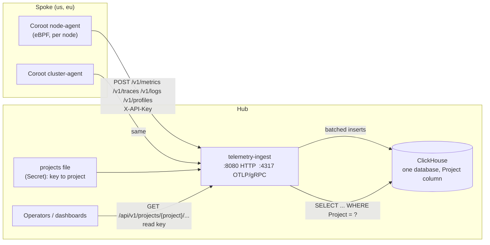

# Telemetry ingest: Coroot agent data stored and served by the hub

`platform-mvp/telemetry-ingest` is a hub service that receives what the Coroot
node-agent and cluster-agent send from each spoke, stores it in ClickHouse, and
serves it back through a small read API, one project per fleet cluster. It
replaces the Coroot **server's collector and storage** for the fleet. Coroot's
UI is not part of it: [19-coroot-agents.md](19-coroot-agents.md) describes the
upstream server this can stand in for.

**Status:** the service, its ClickHouse schema and the Chainsaw checks are
written and tested outside a cluster: unit tests, an integration test against
a real ClickHouse 24.8, and the Chainsaw helper checks run against the built
image. **Not yet run:** the Chainsaw tests through Chainsaw itself, the chart on
a cluster, and a real Coroot node-agent sending to it. Whether the agents accept
this server in place of Coroot's (they also poll `GET /v1/config`) is untested.

## Where it sits



It follows the pattern the platform already uses: spokes push to the hub, the
hub never reaches into a spoke to collect. The agents only need a URL and an
API key, so the spoke chart's `coroot.corootURL` can point at this service
instead of the Coroot server without any spoke-side change, provided the
agents accept what it implements (below).

## Endpoints

Ingest, same paths and header as the Coroot agents use:

| Endpoint | Body | Notes |
|---|---|---|
| `POST /v1/metrics` | Prometheus remote-write, `Content-Encoding: snappy` | 204 on success |
| `POST /v1/traces` | OTLP, protobuf or JSON | answered in the encoding it was sent in |
| `POST /v1/logs` | OTLP, protobuf or JSON | same |
| `POST /v1/profiles?service.name=...&k=v` | pprof, gzip or plain | other query parameters become labels; answers **200**, because the node-agent treats any other status as a failed upload |
| OTLP/gRPC `:4317` | traces and logs | key in `x-api-key` metadata |

`GET /v1/config` is **not** implemented: agents that poll it for database
instrumentation will get 404. See "Left out".

Authentication: `X-API-Key: <key>` or `Authorization: Bearer <key>`. A missing
or unknown key is **401**: there is no default project. A full buffer answers
**503** with `Retry-After`, so the agent retries instead of the data being lost.

Read API, scoped to one project. A read key opens only its own project's path;
anything else is 403, whether or not the project exists. Responses are
`{"data": ...}`. `from` and `to` take RFC 3339 or unix seconds (default: the
last hour).

| Endpoint | Query parameters |
|---|---|
| `GET /api/v1/projects/{p}/metrics` | none: metric names |
| `GET .../metrics/series` | `name`, `match.<label>=<value>`, `limit` |
| `GET .../metrics/query_range` | `name`, `match.*`, `from`, `to`, `step` (seconds), `rate=true`, `from_zero=true` |
| `GET .../traces/services`, `.../traces` | `service`, `name`, `status`, `min_duration_ms`, `root=true`, `limit` |
| `GET .../traces/{trace_id}` | the spans of one trace |
| `GET .../logs/services`, `.../logs` | `service`, `severity`, `q` (substring), `trace_id`, `limit` |
| `GET .../profiles` | services and profile types seen |
| `GET .../profiles/top` | `service`, `type` (e.g. `cpu:nanoseconds`), `limit`, `format=folded` |

`rate=true` turns a counter into a per-second rate over `step`-second buckets
and treats a drop as a counter reset.

`from_zero=true` (with `rate=true`) counts a counter's **first appearance** as an
increase. The node-agent creates counters such as a failed-connect counter, or a request
status like `5xx`, at the first event, so the first stored value is that event; a rate
needs two readings and would drop it, which makes the first error ever invisible. The
option applies only to a series that was **created inside the query range**, decided
from the series' first stored sample. A counter that already existed holds an accumulated
value, and treating that as an increase would produce a large false spike, so it is left
alone. The birth value is spread over one step (`value / step`). Two limits: it assumes the
counter started at zero when it was created, which is true for the agent's event counters
but not for counters that start from an accumulated value, such as the cgroup CPU counter, so
use it only for the former; and "created" means the first sample still within retention. Most node-agent metrics are counters
(`container_net_tcp_successful_connects_total`), so this is what you want for
them. `format=folded` gives the text flamegraph tools read.

```sh
curl -H "X-API-Key: $READ_KEY" \
  "http://telemetry-ingest/api/v1/projects/us/metrics/query_range?name=container_net_tcp_successful_connects_total&match.container_id=/k8s/shop/cart/app&step=15&rate=true"
```

## Projects and keys

A JSON file, mounted from a Secret and re-read every 10 seconds:

```json
{"projects": [
  {"name": "us", "ingestKeys": ["<agent key, 16+ chars>"], "readKeys": ["<reader key>"]},
  {"name": "eu", "ingestKeys": ["..."]}
]}
```

A key belongs to exactly one project and one role; ingest keys cannot read and
read keys cannot write. Duplicate keys, short keys and bad names are rejected.
A reload that does not validate is logged and the previous file stays in force;
a bad file at startup stops the service. Keys are held as SHA-256 digests.

## Storage

One ClickHouse database; **every table starts its sort key with `Project`**, so
a project's rows are contiguous and a query for one project does not read
another's. Each table has a daily partition and a TTL that is re-applied on
every start (`--ttl-metrics`, `--ttl-traces`, `--ttl-logs`, `--ttl-profiles`).

| Table | Holds | Notes |
|---|---|---|
| `metrics_samples` | project, metric, series hash, time (ms), value | narrow: no labels |
| `metrics_series` | project, metric, series hash, labels | each label set once; `ReplacingMergeTree` |
| `metrics_metadata` | metric family, type, help, unit | |
| `traces_spans` | OTLP spans with events and links | bloom index on trace id |
| `logs_records` | OTLP log records | token index on the body |
| `profiling_samples` | service, type, window, labels, value, stack hash | |
| `profiling_stacks` | stack hash to frames (leaf first) | each stack once |
| `profiling_services` | services and types seen | filled by a materialized view |
| `schema_migrations` | applied migration versions | |

Differences from the Coroot server's schema, on purpose:

- **Labels once.** Coroot repeats the label map on every sample row; here a
  sample is `(hash, time, value)` and the labels live in `metrics_series`.
- **One database, project column,** not one database per project.
- **Millisecond timestamps** are kept; Coroot truncates to seconds.
- **No silent loss.** Inserts are retried; when the buffer fills, ingest
  answers 503 instead of dropping the batch.
- **Versioned migrations.** `migrations` in `store/schema.go` is append-only:
  a shipped entry is never edited, a change is a new entry.

The tables are **not** compatible with Coroot's UI. Pointing Coroot at this
database would need the upstream schema.

## Configuration

Flags (`--help` lists all): `--listen`, `--grpc-listen`, `--projects-file`,
`--clickhouse-addr`, `--clickhouse-database`, `--clickhouse-user`,
`--clickhouse-password-file`, `--clickhouse-tls`, the four `--ttl-*`,
`--batch-rows`, `--max-buffered-rows`, `--flush-interval`, `--max-body-bytes`.

`/healthz` answers as soon as the process runs, so a ClickHouse outage does not
get a healthy service restarted. `/readyz` needs ClickHouse reachable and the
schema migrated. `/metrics` exposes request counts by signal and status, and
per-signal rows written, dropped, failed and buffered.

## Deploy

Off by default. On the hub, with the image built and loaded or pushed:

```sh
make deploy-local TELEMETRY_HUB=true      # whole lab, image loaded into kind
make deploy-wave3 TELEMETRY_HUB=true      # or only the hub services, on an existing hub
```

The `hub-services` chart (`telemetryIngest.*` values) then runs a one-replica
ClickHouse StatefulSet and the service in `monitoring`. It generates an ingest
key and a read key per fleet cluster into Secret `telemetry-ingest-keys`
(`<cluster>.ingest`, `<cluster>.read`), and derives the service's projects file
from the same Secret, so the two cannot disagree. Keys are kept on upgrades.

```sh
kubectl -n monitoring get secret telemetry-ingest-keys -o go-template='{{index .data "us.read"}}' | base64 -d
```

### Chainsaw tests against a GKE cluster

`tests/telemetry-ingest-gke/` is a second Chainsaw suite for a cluster that runs
the service and the node-agent together, such as a GKE cluster, rather than the
kind lab. It shares the helpers in `tests/telemetry-ingest/helpers`.

```sh
make validate-telemetry-ingest-gke GKE_CONTEXT=gke_<project>_<zone>_<cluster> [TI_GKE_PROJECT=gke]
```

It needs the Chainsaw CLI, `kubectl`, `jq`, `curl` and `python3`. The target writes
a kubeconfig for that one context (`tests/telemetry-ingest-gke/kubeconfig-hub`,
mode 600, ignored by git) and refuses a `kind-*` context.

| Test | What it proves |
|---|---|
| `01-deployed` | ClickHouse and telemetry-ingest are up, and the project has an ingest and a read key (the failure message lists the projects that do exist) |
| `02-ingest-and-query` | the same ingest and read-back checks as the kind suite |
| `03-auth` | the same key and role checks |
| `04-node-agent` | the real node-agent: the DaemonSet is ready on every node, containers are attributed to pods (`/k8s/<namespace>/<pod>/<container>`), every node reports container metrics, samples are under five minutes old, and the service dropped no metric rows. Rows written for traces, logs and profiles are printed but not required, because they depend on what the cluster runs. |

Differences from the kind suite, and what to know before running it:

- **One project.** `TI_PROJECT` names the project the checks use (default `gke`).
  The two-project isolation checks need `TI_OTHER_PROJECT`; the Makefile target
  leaves it empty, so they print `skipped` and say why, rather than pass without
  testing anything. Adding a second project means re-rendering the chart, which
  generates new keys if you install with `helm template | kubectl apply`, so rerun
  `copy-telemetry-credentials.sh` afterwards.
- **No NodePort or spoke-reachability step.** The Service is a ClusterIP here.
- **It writes test data into the real project.** The metric
  `chainsaw_ti_connects_total` (container `/k8s/shop/cart/app`, which no pod
  has, so the service map ignores it), the service `chainsaw-cart` and a few
  log lines and spans. Retention removes them (14 days for metrics, 7 for the
  rest). Every check reads only the rows of its own run.
- **Run against your own cluster only.** The checks create unauthenticated and
  wrong-key requests on purpose (401 and 403 counters rise) but change nothing in
  Kubernetes.

The checks can also run without Chainsaw, against any reachable service, for a
quick look: set `TI_URL` (for example a port-forward), `TI_PROJECT`,
`TI_OTHER_PROJECT=`, `TI_KEY_<PROJECT>_INGEST` and `TI_KEY_<PROJECT>_READ`, then
`bash tests/telemetry-ingest/helpers/checks.sh <check>` for `ingest_all`,
`check_metrics`, `check_traces`, `check_logs`, `check_profiles`, `check_auth`,
`check_isolation` or `check_node_agent` (which also uses `TI_KUBE_CONTEXT`).

## Reaching the service from the spokes

Inside its own cluster the service is always `telemetry-ingest.monitoring.svc`.
Other clusters need an address on the hub, which `telemetryIngest.service` in the
hub chart provides:

| `service.type` | Use | A spoke's `nodeAgent.collectorURL` |
|---|---|---|
| `ClusterIP` (default) | agents in the same cluster as the service | `http://telemetry-ingest.monitoring.svc.cluster.local` |
| `NodePort` | the kind lab | `http://hub-control-plane:30081` |
| `LoadBalancer` | a cloud | `http://<load balancer address>` (port 80) |

`make deploy-local TELEMETRY_HUB=true` (or `deploy-wave3`) selects `NodePort`:
HTTP on 30081 and OTLP/gRPC on 30318, chosen to be clear of Coroot (30080,
30317) and the metrics ingest (30909). Spoke pods reach it over the Docker
network the way they reach the metrics ingest.

On a cloud, use a load balancer that is internal to your network, not a public
one. For example on GKE:

```sh
helm upgrade --install hub-services deploy/platform-mvp/chart/hub-services \
  --set telemetryIngest.enabled=true \
  --set telemetryIngest.service.type=LoadBalancer \
  --set 'telemetryIngest.service.annotations.networking\.gke\.io/load-balancer-type=Internal' \
  --set 'telemetryIngest.service.loadBalancerSourceRanges={10.0.0.0/8}'

kubectl -n monitoring get svc telemetry-ingest \
  -o jsonpath='{.status.loadBalancer.ingress[0].ip}'     # the address to give the spokes
```

Add `networking.gke.io/internal-load-balancer-allow-global-access: "true"` if a
spoke is in another region. The two clusters' networks must be able to reach each
other (the same VPC or peered VPCs, with a firewall rule that allows it). The
GKE annotations are from GKE's documentation; they have not been tried here.

Be aware of two properties of this exposure:

- **One port serves both ingest and the read API.** Whoever can reach the ingest
  endpoint can also try the read endpoints. The keys are the only protection,
  and a spoke only ever holds its ingest key. Keep the address private and
  restrict it (`loadBalancerSourceRanges`, firewall rules, or a NetworkPolicy).
- **The traffic is plain HTTP**, so keys cross the network in clear. That is
  acceptable on the lab's private Docker network, and not across the internet.
  The node-agent supports https with a CA (`nodeAgent.caSecret`); the service
  itself does not terminate TLS yet, so put a TLS-terminating proxy or load
  balancer in front for anything beyond a private network.

The Chainsaw test `01-deployed` checks that the Service is a NodePort on the
pinned ports and that a pod on the `us` spoke reaches
`hub-control-plane:30081`, getting 200 from `/healthz` and 401 for an
unauthenticated ingest, which shows it is telemetry-ingest answering.

```sh
make test-ti-chart   # the Service for each type, bad values refused; rendering only
```

## Node-agent on the spokes, without the Coroot operator

The spoke chart can run Coroot's node-agent as a plain DaemonSet
(`templates/node-agent.yaml`, values `nodeAgent.*`). No Coroot operator, `Coroot`
CRD or Coroot Helm chart is involved: the agent is one image configured by two
environment variables, `COLLECTOR_ENDPOINT` (it appends `/v1/metrics`,
`/v1/logs`, `/v1/traces` and `/v1/profiles`) and `API_KEY` (sent as
`X-Api-Key`). It does not call `/v1/config`; that is the cluster-agent's job,
and this path does not run the cluster-agent.

```sh
# 1. this cluster's ingest key, from the hub to the spoke (never in values)
hack/platform-mvp/copy-telemetry-credentials.sh us kind-us kind-hub
#   or, for every spoke in the kind lab:  make spoke-telemetry-credentials

# 2. the chart: a pinned image and the hub's address as the spoke sees it
helm upgrade --install spoke deploy/platform-mvp/chart/spoke --kube-context <spoke> \
  --set nodeAgent.enabled=true \
  --set nodeAgent.collectorURL=http://<hub address>:<port> \
  --set nodeAgent.image.tag=<pinned version>
```

### Delivering the key

`copy-telemetry-credentials.sh <project> [spoke-context] [hub-context]` copies
`<project>.ingest` from the hub's Secret `telemetry-ingest-keys` into Secret
`hub-telemetry-credentials` (entry `apiKey`) in the spoke's `telemetry-agent`
namespace, creating the namespace if needed. The contexts default to
`kind-<project>` and `kind-hub`; on GKE pass them explicitly, for example
`copy-telemetry-credentials.sh gke gke_proj_zone_spoke gke_proj_zone_hub`
(`kubectl config get-contexts` lists them). Only the **ingest** key goes to the
spoke. The read key never leaves the hub.

- **The key is never in an argument or in the output.** It travels through a
  pipe, so it does not appear in a process list or a log.
- **Safe to rerun.** It reports `created`, `updated` or `unchanged`. A key
  shorter than 16 characters, a project the hub has no ingest key for (the error
  lists the projects that have one) and an unreadable hub Secret all stop it
  before anything is written to the spoke.
- **Rotating a key.** Delete the hub Secret and re-apply the hub chart for a new
  key, then run the script again. The agents read the key when a pod starts, so
  running pods keep the old one until restarted: the script prints the command,
  or `RESTART=1` runs it. Until then the old key is refused (401) and the agents
  spool and retry.
- **Variables** for other names: `HUB_NAMESPACE`, `HUB_SECRET`, `AGENT_NAMESPACE`,
  `AGENT_SECRET`, `AGENT_DAEMONSET`, `KUBECTL`.

```sh
make test-telemetry-credentials   # against a stub kubectl; needs no cluster or Docker
```

Things the chart settles for you, and why:

- **`hostPID` and `privileged` stay on.** The agent loads eBPF programs and reads
  the host's files (machine id, container runtime sockets, logs) through
  `/proc/1/root`. Without them it cannot identify nodes or containers.
- **No Kubernetes API access.** No token, no RBAC: it reads cgroups and runtime
  sockets on the node.
- **A spool for metrics the hub cannot take.** The agent keeps up to
  `nodeAgent.spoolSize` on disk (an `emptyDir`, so it survives a container
  restart) and retries with a 5 to 60 second backoff. A full hub buffer answers
  503 and a wrong key 401: both are retried, never dropped. Only 400 and 413
  discard a batch. So a bad key shows up as a growing spool and repeated
  warnings in the agent's log.
- **Pinned image.** `nodeAgent.image.tag` has no default; the render fails
  without one, so a deploy never floats on `latest`.
- **One agent path at a time.** `coroot.enabled` and `nodeAgent.enabled` together
  are refused: two agents would report the same containers.

The hub address has to be reachable from the spoke's pods: see "Reaching the
service from the spokes" below. Plain http is fine on a private network; for
https set `nodeAgent.caSecret.name` for a private CA.

Without the cluster-agent there is no Kubernetes inventory (which workload owns
a pod). Containers are still identified as `/k8s/<namespace>/<pod>/<container>`.

```sh
make test-node-agent-chart   # render checks and a real API server (k3s); needs Docker. SKIP_APISERVER=1 skips k3s,
                             # which needs fs.inotify.max_user_instances raised while kind clusters run
```

## Test

```sh
make test-ti               # unit tests: decoders, auth, batching, handlers
make test-ti-integration   # the whole path against a real ClickHouse (needs Docker)
make validate-telemetry-ingest   # the Chainsaw tests, against a deployed hub
```

The integration test posts remote-write, OTLP and pprof through the real
handlers and reads everything back through the query API.

### Chainsaw tests

`tests/telemetry-ingest/` is a separate Chainsaw suite, not part of
`make validate`, because the service is opt-in. Deploy with `TELEMETRY_HUB=true`
first. It needs the Chainsaw CLI (`make install-chainsaw`), `kubectl`, `jq`,
`curl` and `python3` on the machine that runs it; the Makefile target sets
`TI_HELPERS` so the tests find their scripts.

| Test | What it proves |
|---|---|
| `01-deployed` | ClickHouse and telemetry-ingest are up; every fleet cluster has an ingest and a read key |
| `02-ingest-and-query` | remote-write metrics (with a counter reset), OTLP/JSON traces with hex ids, logs and a pprof profile are stored and read back through the API: labels, values, millisecond times, `rate=true`, trace and log search, top and folded stacks; the same metric in `us` and `eu` stays separate and eu sees none of us' traces, logs or profiles |
| `03-auth` | no key or an unknown key is 401, an ingest key cannot read and a read key cannot write, another project's path or one that does not exist is 403, a malformed query is 400 |

Each test creates its own data and reads only that, so they pass in any order
and on repeat runs. The logic is in `tests/telemetry-ingest/helpers/`;
`checks.sh` can also run against any URL (`TI_URL` plus `TI_KEY_<PROJECT>_<INGEST|READ>`),
which is how it was exercised against a locally built image.

## Service map

`hack/platform-mvp/servicemap/` draws the services and who calls whom from the
node-agent's data. It is a small local program plus a page; it reads the read API
and `kubectl`, and stores nothing. Standard library Python only.

```sh
kubectl --context <ctx> -n monitoring port-forward svc/telemetry-ingest 8080:80 &
export TELEMETRY_READ_KEY=$(kubectl --context <ctx> -n monitoring get secret telemetry-ingest-keys \
    -o go-template='{{index .data "gke.read"}}' | base64 -d)
python3 hack/platform-mvp/servicemap/server.py --project gke --kube-context <ctx>
# open http://127.0.0.1:8099
python3 hack/platform-mvp/servicemap/server.py --project gke --kube-context <ctx> --print 1h   # the graph as JSON
```

**Looking back at something that is over.** The default view is the last N minutes, which
averages a short incident away. Give a fixed range instead (RFC 3339 or unix seconds; `--to`
defaults to now, and a range is limited to 30 days):

```sh
python3 hack/platform-mvp/servicemap/server.py --project gke --kube-context <ctx> \
    --from 2026-11-07T13:48:00Z --to 2026-11-07T13:52:00Z          # prints the graph as JSON
# or in the page: http://127.0.0.1:8099/?from=2026-11-07T13:48:00Z&to=2026-11-07T13:52:00Z
```

With a fixed range the page shows the range in its status badge, disables the window picker
and stops refreshing. `/api/graph?from=...&to=...` takes the same parameters and answers
a 400 that says why for a backwards, malformed or too-long range.

How it works:

1. **Edges** are the node-agent's per-connection counters, read as rates over the
   window through `metrics/query_range?...&rate=true`:
   `container_net_tcp_successful_connects_total{destination, actual_destination}`,
   `container_net_tcp_failed_connects_total{destination}` and
   `container_http_requests_total{status}`. For each series the rate points are added up and
   divided by **every bucket of the range**, then the series of one caller and destination are
   summed. A bucket in which a series sent nothing has no point, so it counts as zero: a quiet
   stretch lowers the rate, and an outage reads as one. Averaging only the points that exist
   would skip every quiet moment. It would also count a restart twice, because the pod IP is a
   label (`actual_destination`), so the replacement pod is a new series that starts as the old
   one ends.
2. **Loopback is not an edge.** A connection to `127.0.0.0/8`, `::1` or `localhost` stays
   inside one host or one pod, so it is not a call between services and is dropped (either
   the address dialled or the peer actually reached being loopback is enough). Look-alikes
   such as `128.0.0.1` or `10.0.0.127` are kept. The graph reports how many container to
   destination pairs it dropped as `ignored.loopback`. With a service mesh this means the
   app's calls to its own sidecar disappear, and the sidecar's calls to other pods remain, as
   the workload's calls.
3. **Names** come from `kubectl get pods,services -A`: the caller's
   `container_id` (`/k8s/<namespace>/<pod>/<container>`) maps to a pod and its
   owning workload, and the destination address to a pod IP or a Service
   ClusterIP. `actual_destination` (the pod behind a Service address) is tried
   first. An address no pod or Service owns is drawn as an external node.
4. **Edge health** is the share of failed calls on an edge:
   - **Request errors:** HTTP 5xx, and the gRPC codes `UNKNOWN`, `DEADLINE_EXCEEDED`,
     `UNIMPLEMENTED`, `INTERNAL`, `UNAVAILABLE` and `DATA_LOSS`. gRPC runs over HTTP/2,
     which the agent counts in `container_http_requests_total` with status
     `grpc:<CODE>`. Codes the caller causes (`NOT_FOUND`, `INVALID_ARGUMENT`,
     `PERMISSION_DENIED`, `UNAUTHENTICATED`, ...) are not counted, as 4xx is not.
   - **Failed connects:** a refused or timed-out connection never becomes a request, so
     the request counters cannot see it. Each failed connect counts as one failed call:
     `(request errors + failed connects) / (requests + failed connects)`. This is an
     approximation, since a client that retries makes several attempts, but it keeps a
     callee that is refusing connections from looking healthy while some requests still
     get through. The edge's `errBasis` is `http`, `http+tcp` or `tcp`.
   - **No requests seen at all** (a database, a queue): the share of connects that
     failed, `failed / (successful + failed)`.
   The map asks for `from_zero=true`, so the first failure a counter ever records
   counts too. This needs a telemetry-ingest that supports the option; an older one ignores
   it, and the map then behaves as before.
   Latency (p95) is not wired in.

**Database and broker edges.** The agent counts a client's queries to a data store the way it
counts HTTP requests: `container_<db>_queries_total{status}` with the destination labels and a status of
`ok`, `failed` or `unknown`, and a latency histogram for most protocols. The map reads these for
Postgres, MySQL, Redis, Memcached, MongoDB, ClickHouse, Cassandra, FoundationDB, Kafka, RabbitMQ and
NATS. It first asks which metric names the project has and queries only the protocols the cluster
reports, so a cluster without Postgres costs nothing. ZooKeeper (a different status vocabulary), Dubbo
(an RPC protocol) and DNS are not mapped.

- **The edge** is the same edge as the connection edge to that database, now with a rate (`queries/s`,
  `req/s` or `msgs/s`), an error share (the failed queries, plus failed connects as for HTTP; `unknown` is
  a call, not an error) and a p95. It also carries `protocol` and `protocols`, and the database node
  carries `serves` (for example `["redis"]`), which the page shows on the node. The `errBasis` is `calls`
  or `calls+tcp`.
- **p95** is computed from the latency histogram with linear interpolation inside the bucket that holds
  the rank, as Prometheus does. When the rank falls in the overflow bucket it is the largest finite bound
  ("at least this"). It is the **client's** measurement. RabbitMQ and NATS count messages and keep no
  histogram, so their edges show no p95.
- **One workload reached over several protocols** (say ClickHouse over HTTP and over its native
  protocol) is one edge. Rates add, the unit becomes `calls/s`, and the p95 is that of the protocol that
  carries most of the calls, because HTTP and database histograms have different buckets and cannot be
  added.
- **How far to trust the latency.** The agent matches each request to its response, and that can go wrong
  for a protocol that keeps a connection open across statements. It was checked against the server's own
  view on a real cluster. For **Redis** the client's and the server's histograms agree (p50 2.5 ms and p95
  4.8 ms in both). For **ClickHouse** they did not: the client reported p95 8.7 s with 10% of calls over 5 s,
  while the ClickHouse container's own histogram said 22 ms and its `query_log` said 72 ms. So ClickHouse
  edges show rate and errors and **no latency**. The other protocols' latency has not been checked this way;
  compare the client's histogram with the matching `container_<db>_inbound_queries_duration_seconds_total`
  of the database container before relying on one.

- **The key** comes from `TELEMETRY_READ_KEY` or `--read-key-file`, never an
  argument, and the program refuses abbreviations of the option names so a
  mistyped `--read-key <secret>` is not taken as a file name and echoed.
- **Errors are shown, not hidden.** A rejected key, an unreachable service (it says
  to check the port-forward) and a wrong project each give a clear message; the
  page shows it instead of an empty map.
- **Partial data is flagged.** One call returns at most 500 series. If a metric
  has more, the page shows "(partial data)" and the reason on hover; use a shorter
  window.
- **What is missing:** only outbound connections of containers the agent tracked
  appear (a container is reported after about 30 seconds), and nothing is named
  for a workload `kubectl` cannot see. A map from traces (cross-service parent
  spans) is not built.

### Several clusters on one map

A project in `telemetry-ingest` is already one cluster, so the read API needs no change. The map reads one
project per cluster and names things from that cluster's own Kubernetes API. Describe the fleet in a JSON file
and pass it with `--clusters`:

```json
{"api": "http://127.0.0.1:8080",
 "clusters": [
   {"name": "us",  "project": "gke-us", "kubeContext": "gke_proj_zone_us", "readKeyFile": "us.key"},
   {"name": "dc1", "project": "dc1", "k8sFile": "dc1-inventory.json", "readKeyEnv": "DC1_READ_KEY",
    "api": "https://telemetry.dc1.example.com"}]}
```

```sh
python3 hack/platform-mvp/servicemap/server.py --clusters fleet.json            # the page, with a cluster filter
python3 hack/platform-mvp/servicemap/server.py --clusters fleet.json --print 1h  # the graph as JSON
```

- **Keys are never in the file.** Each cluster takes its read key from a file (`readKeyFile`) or an environment
  variable (`readKeyEnv`). A field such as `readKey` or `token` is refused with a message that does not repeat the value.
- **The map never guesses which cluster to read.** Each cluster must give exactly one of `kubeContext` and `k8sFile`
  (the output of `kubectl get pods,services,nodes -A -o json`, for a cluster the map host cannot reach). The current
  `kubectl` context is never used, because the wrong cluster would give a plausible, wrong map. Relative paths are
  relative to the file.
- **Ids carry the cluster** (`us/shop/frontend`, `dc1/shop/frontend`), because every cluster has its own `shop/frontend`.
  A single cluster (`--project`) keeps its plain ids. Each node and edge says which `cluster` it belongs to, and an
  external endpoint is one node however many clusters call it.
- **Calls between clusters** are recognised only by an address the target cluster **exposes**: a load balancer IP or
  host name, an external IP, or a node address with a NodePort. Pod and Service addresses are never matched across
  clusters, because they overlap: `10.0.0.11` in one cluster is a different pod from `10.0.0.11` in another, so such an
  address always means the caller's own cluster. The caller's own exposed addresses are tried first. An address two
  *other* clusters both claim cannot be told apart, so it is left as an external endpoint and counted in
  `ignored.ambiguous`. Such an edge has `crossCluster: true`, is drawn dashed, and belongs to the caller's cluster.
- **One cluster failing does not blank the map.** Clusters are read in parallel. One whose telemetry or inventory cannot
  be read is reported (`clusters[].ok` and `error`, and a warning, shown in the page's badge and overview) and the others
  are drawn. A cluster whose inventory is unreadable has no known exposed addresses, so calls to its load balancer show as
  external. A cluster whose telemetry alone failed is still known by its addresses, so calls *to* it are still drawn,
  and its own outgoing calls are what is missing. Only when no cluster can be read is it an error.

What this does not do yet: the map host still needs `kubectl` access to every cluster (or an exported inventory file),
so a datacenter the host cannot reach has to supply a file; each spoke pushing its own inventory is not built. A call is
recognised only by the exposed addresses above, so traffic through a path that rewrites addresses (a proxy or NAT that
is not one of those) shows as external. Everything is read over plain HTTP with static keys.

```sh
make test-servicemap   # the real code against a stub of the read API and a fixture cluster; python3 only
```

The tests check the numbers (summed series, error share, counter-derived edges),
that self-edges, host processes and unknown pods are skipped, that the key is
sent in a header and never in a URL or message, and each failure message. They
use a stub, so they do not prove the map against a real node-agent's data.

## Left out, on purpose

- **`GET /v1/config`.** Coroot uses it to tell agents which databases and
  services to scrape and with what credentials. Dropped for now; agents
  without it still send node, container and connection telemetry.
- **Coroot's analysis and UI** (service map, inspections, incidents, RCA).
  The read API returns raw telemetry; building a service map from the
  connection metrics is separate work (see `hack/platform-mvp/servicemap/`).
- **Per-tenant scoping.** A project is a fleet cluster. Telemetry inside a
  cluster is not split by tenant.
- **ServiceAccount-token auth.** The platform's other services use projected
  tokens; the Coroot agents only send an API key, so this uses keys for now.
- **Clustered ClickHouse.** Tables are plain `MergeTree` and
  `ReplacingMergeTree`; replicated and distributed variants are not created.
- **Automatic key delivery.** `copy-telemetry-credentials.sh` is run by hand or
  from the Makefile. A hub controller that pushes the key to each spoke through
  the connection the hub already holds (and restarts the agents on rotation)
  would remove that step; it is not written.
