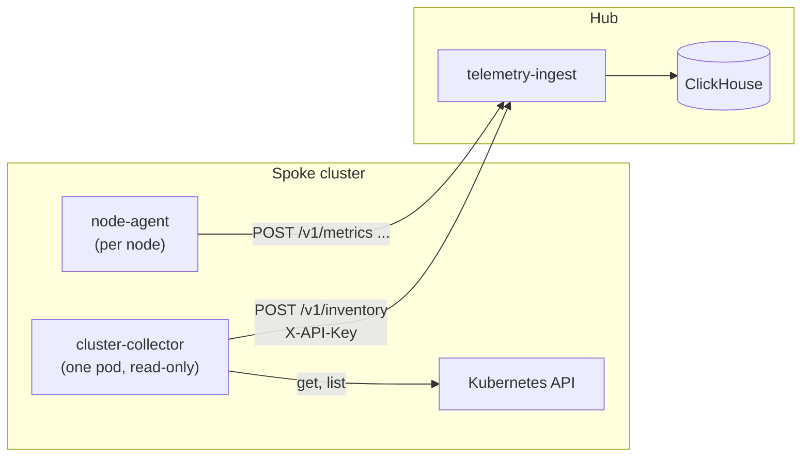

# Cluster collector: what is in each cluster

`platform-mvp/cluster-collector` is one small, read-only Deployment per cluster. It reads the cluster's Kubernetes API and reports what is **in** it to the hub's
[telemetry-ingest](20-telemetry-ingest.md): nodes, namespaces, workloads (deployments, stateful sets, daemon sets, cron jobs), pods, volume claims, autoscalers
(HPA and KEDA `ScaledObject`) and events. The [node-agent](19-coroot-agents.md) reports what is **happening** (CPU, memory, connections, requests, logs, profiles);
this reports what is **supposed to be there and in what state**. Together they can tell "scaled to zero on purpose" from "should be running and is not".

Like the other agents it **only pushes**: the hub never reaches into the cluster. It authenticates with the cluster's ingest key, so the project is the key's.

**Status:** unit-tested with fake Kubernetes clients, tested against a real ClickHouse and, end to end, against a real API server (k3s). **Not yet run** on a cluster
of yours, or at a size of thousands of nodes (see Limits). The Applications page uses it to say why an application is silent (see [21-telemetry-ui.md](21-telemetry-ui.md)).



## What it reports

Each object has a `kind`, `uid`, `namespace` (not for nodes and namespaces), `name`, its `labels` (at most 64), `created`, and `data`: a few attributes picked by name.
The service holds the list of attributes each kind may carry, and **refuses** a batch with any other.

| Kind (path) | Attributes |
|---|---|
| `node` (`nodes`) | `ready`, `conditions` (name to True/False/Unknown), `unschedulable`, `taints` (`key=value:effect`), `kubelet`, `os`, `arch`, `runtime`, `zone`, `region`, `instance_type`, `internal_ip`, `capacity` and `allocatable` (`cpu_m`, `memory_bytes`, `pods`, `ephemeral_bytes`) |
| `namespace` | `phase` |
| `deployment`, `statefulset`, `daemonset` | `desired`, `current`, `ready`, `available`, `updated`, `unavailable`, `generation`, `observed_generation`, `strategy`, `containers` (name, image, `requests`, `limits`); deployments and stateful sets add `paused`; daemon sets `misscheduled` |
| `cronjob` | `schedule`, `suspend`, `active`, `last_schedule`, `containers` |
| `pod` | `phase`, `reason` (such as `Evicted`, `Unschedulable`), `node`, `ip`, `owner_kind`/`owner_name`, **`workload_kind`/`workload_name`** (the deployment or cron job it really belongs to, found through its ReplicaSet or Job), `ready`, `conditions`, `qos`, `started`, `terminating`, `restarts`, `containers` (name, image, `state`, `reason`, `exit_code`, `last_reason`, `last_exit_code`, `restarts`, `ready`, `requests`, `limits`) |
| `pvc` | `phase`, `storage_class`, `requested_bytes`, `capacity_bytes`, `access_modes`, `volume` |
| `hpa` | `target_kind`, `target_name`, `min`, `max`, `current`, `desired`, `metrics` (type, name, `target`, `current`, such as `70%` and `45%`), `conditions`, `last_scale` |
| `scaledobject` | `target_kind`, `target_name`, `min`, `max`, `triggers` (the **types** only), `ready`, `active`, `fallback`, `paused`, `conditions` |

Units: CPU in millicores (`cpu_m`), memory and storage in bytes. A deployment with no replica count set wants one, as Kubernetes does.

**Events** (`warning` by default, or `all`, or `none`): `uid`, `namespace`, `kind` and `name` of the object, `type`, `reason`, `message` (at most 1000 bytes), `count`, `first`, `last`, `source`.

## What it never reads

The mappers pick fields by name; none copies an object or a section of one. **Not read, so never sent:** annotations (they hold a last-applied copy of the whole object, and
what operators put there), environment variables, commands and arguments, volumes and mounts, image pull secrets, ConfigMap and Secret contents, a KEDA trigger's `metadata`
and authentication references (connection strings live there), and the node's provider id. The service's allowlist is the second wall: a collector that was changed to send
`annotations` or `env` is answered 400 and nothing is stored. The end-to-end test plants a marker in each of these places and searches everything the API serves, and the
collector's and the service's logs, for it.

The collector's service account may **get and list** the kinds above and nothing else: not Secrets, not ConfigMaps, and no write. The chart test checks that.

## How it reports

- **Changes.** Every 30 s it lists the cluster and compares with what it last reported. Only objects that changed (or are new) are sent, and the ones that are gone.
  Looking is by polling lists, not watching: simpler and without the failure modes of a lost watch, at the price of an up-to-30 s delay and a list of each kind every look.
- **A resync** every 30 min: everything is sent again, then a **sweep** per kind that was read completely says "whatever of this kind was not sent since the look began is gone".
  This repairs what the changes cannot: a deletion that happened while the collector was down, a report that was lost for good.
- **A heartbeat**: a look with nothing new is an empty report, so the hub knows the collector is alive (`last_received` in `GET .../inventory`).
- **A kind that cannot be read** (a permission is missing, the API timed out) is left as it was and never swept: an empty answer from a failed call is not "everything was
  deleted". A collector that cannot read **any** kind says nothing at all, so it shows as silent instead of as an empty cluster or a healthy one.
- **A report that fails** is not remembered as sent: the next look makes it again. Batches (at most 500 objects, 6 MiB) go in order, and the sweeps ride on the last, so a failure
  part way never deletes what an earlier batch carried.
- **An object the service would refuse** (a name it does not take, attributes over 16 KiB) is left out and counted, not allowed to stop every report from the cluster.

## In ClickHouse

`inventory_objects` keeps **versions**: a row when an object changes, a row with `Deleted` when it goes. What is current is the newest row of each object, and its history is the
rows. `inventory_events` has a row each time an event's count changes (read as the newest per event); `inventory_batches` a row per report (the heartbeat). Retention is
`--ttl-inventory` (14 days). An object **not reported for 24 hours** (no change and no resync) is not current: the collector is gone, and the inventory should not pretend otherwise.

## Reading it

Read key, scoped to the project, `{"data": ...}` as the rest. Parameters: `cluster`, `namespace`, `name` (exact), `limit` (default 200, at most 1000).

| Endpoint | |
|---|---|
| `GET .../inventory` | each cluster that has reported: `last_received` (the service's clock), `last_collected` (the collector's), and `counts` by kind |
| `GET .../inventory/{kind}` | `nodes`, `namespaces`, `deployments`, `statefulsets`, `daemonsets`, `cronjobs`, **`workloads`** (those four), `pods`, `pvcs`, `hpas`, `scaledobjects`; each `{cluster, kind, uid, namespace, name, labels, created, observed, data}` |
| `GET .../inventory/{kind}/{uid}/history` | the versions of one object, newest first (`limit` at most 200), including the one that records its deletion. One kind, not `workloads` |
| `GET .../inventory/events` | `from`, `to` (default the last hour), `kind` (of the object, such as `Pod`), `name`, `namespace`, `type` (`Normal` or `Warning`), `reason`, `limit` (default 100) |

```sh
# what is scaled to zero, and since when
curl -H "X-API-Key: $READ_KEY" "http://telemetry-ingest/api/v1/projects/gke/inventory/deployments" | jq '.data[] | select(.data.desired == 0) | {namespace, name, observed}'
# how it got there
curl -H "X-API-Key: $READ_KEY" ".../inventory/deployments/$UID/history" | jq '.data[] | {version, desired: .data.desired, deleted}'
# what Kubernetes said
curl -H "X-API-Key: $READ_KEY" ".../inventory/events?namespace=shop&type=Warning" | jq '.data[] | {last, reason, kind, name, message}'
```

**Using it to tell a failure from a decision.** A workload with `desired: 0` was scaled down (by a person, an autoscaler or a KEDA `ScaledObject`: its `min` says whether
zero is allowed). A workload with `desired > 0` and `ready < desired`, or pods in `ImagePullBackOff`, `CrashLoopBackOff` or `Unschedulable`, is a failure. A workload that is
neither listed nor in a recent delete is not in the cluster. Pair it with what the node-agent sent: `desired > 0`, `ready = 0` and no inbound requests is the case to flag.

## Deploy

1. Build and push the image: `make build-cluster-collector-image push-cluster-collector DOCKER_REGISTRY=... IMAGE_TAG=v1`.
2. The key: the spoke already has this cluster's ingest key in a Secret for the node-agent (`hub-telemetry-credentials`, key `apiKey`, in `telemetry-agent`). The collector uses it.
3. In the spoke's values (the namespace and the Secret must exist, as for the node-agent):

```yaml
clusterCollector:
  enabled: true
  clusterName: gke                       # as the hub lists this cluster
  image: { repository: <registry>/cluster-collector, tag: v1 }
  # collectorURL: defaults to nodeAgent.collectorURL
  # events: warning | all | none ; excludeNamespaces: [kube-system] ; interval: 30s ; resync: 30m
```

Render and apply only the collector's objects if you do not want the whole spoke chart applied: `helm template ... -s templates/cluster-collector.yaml`.

**Before relying on it,** run it once by hand against the cluster, from anywhere with a kubeconfig:

```sh
docker run --rm -v ~/.kube/config:/kubeconfig:ro <registry>/cluster-collector:v1 --kubeconfig /kubeconfig --check
```

It prints, for each kind, how many objects it can read, and says which it **cannot** (a missing permission): exit 0 all read, 3 some not, 1 none. `--stdout` prints what it
would send, as JSON lines, without sending. The pod's `/readyz` is ready once a look has been reported and while they keep being: a hub that is down makes it not ready and does
not get it restarted.

| Flag | Default | |
|---|---|---|
| `--endpoint` | | the hub's telemetry-ingest, without a path |
| `--cluster` | | this cluster's name |
| `--api-key-file` or `API_KEY` | | the ingest key. **No flag takes it on the command line**: it would be in the pod's spec and visible to every process |
| `--interval`, `--resync` | `30s`, `30m` | how often it looks, and sends everything again (at least 5 s, and at least 1 m) |
| `--events` | `warning` | `all` adds scaling, scheduling, pulling and killing |
| `--exclude-namespaces` | | comma-separated; their objects and events are left out |
| `--kubeconfig` | the pod's service account | to run outside the cluster |
| `--ca-file`, `--tls-skip-verify` | | for an https hub with a private CA, or a lab |
| `--listen` | `:8082` | `/healthz`, `/readyz` |

## Tests

```sh
make test-cc         # unit tests, race detector, vet, gofmt (Docker)
make test-cc-chart   # the spoke chart's template (Docker, network)
make test-cc-e2e     # k3s + ClickHouse + both images (Docker, ~5 min): scale to zero, a delete, a delete the collector missed, secrets planted everywhere
make test-ti-integration  # the service's side, with the rest of its ClickHouse tests
```

## Limits

- **Polling, not watching.** A look lists every kind: up to 30 s late, and a cost on the API server that grows with the cluster (pages of 500). For clusters of many thousands
  of pods, informers would be the next step; this has not been run at that size.
- **One collector per cluster.** Two with the same cluster name would send each other's objects as changes and sweep with different cut times.
- **Not reported:** init containers, ReplicaSets and Jobs (read only to find a pod's workload), Services, Ingresses, ConfigMaps, Secrets, NetworkPolicies, RBAC, other CRDs than
  KEDA's `ScaledObject`, and usage numbers (that is the node-agent's, and the kubelet's).
- **Events are Kubernetes's:** kept by the API server for about an hour, and only as detailed as the controllers made them. `warning` leaves out the scaling events; use `all` for them.
- **A day's grace.** An object whose newest version is more than 24 hours old is not current; with a resync every 30 minutes that only happens when the collector is gone.
- **No notification.** It stores and serves. The Applications page uses it for the Silent status; the incident detector and the other pages do not use it yet.
