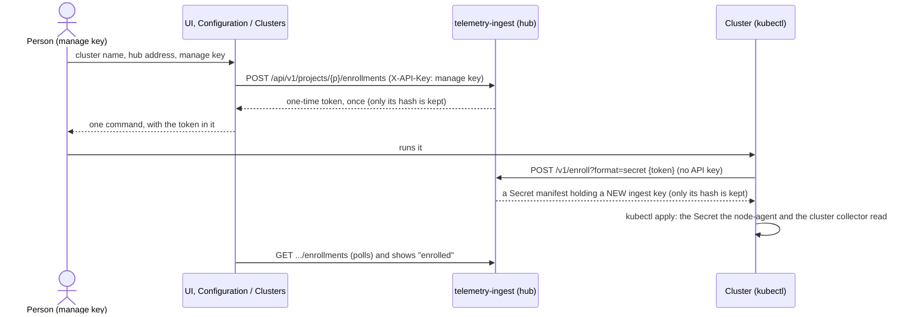

# Enrolling a cluster

A cluster needs an **ingest key** to push telemetry to the hub. Until now that key was copied by hand from the hub's Secret to the spoke
(`copy-telemetry-credentials.sh`). Enrollment replaces the copying: from the UI's **Configuration → Clusters** page a person with a **manage key** makes a
**one-time token** that lasts minutes, the page shows **one command** to run on the cluster, and the cluster trades the token for **a key of its own**.



The command, as the page makes it:

```sh
curl -fsS -X POST 'http://<hub>:30081/v1/enroll?format=secret' -H 'Content-Type: application/json' -d '{"token":"enr_…"}' | kubectl apply -f -
```

It makes the namespace `telemetry-agent` and the Secret `hub-telemetry-credentials` (entry `apiKey`), the ones the node-agent and the cluster collector read by default.
The key goes through the pipe and is never printed. Nothing is pushed into the cluster: the cluster comes to the hub, so the platform's rule that the hub never reaches
into a spoke holds.

## What it is built to do, and not do

- **The token is not the key.** It does nothing but be redeemed, once, within its time (15 minutes by default, 1 minute to 24 hours). It is 256 random bits, shown
  to the person once when it is made; **only its SHA-256 is stored**. Anyone who has it can enroll a cluster until it is used or expires, so the page says not to paste it anywhere.
- **Each cluster gets its own key**, made when the token is redeemed and shown once to the cluster; **only its hash is stored**. A cluster can be cut off without
  touching the others, and the keys in the hub's projects file are not handed out at all.
- **One redemption, one key.** Redeeming is serialised: fifty clusters presenting one token at once get one key between them (tested against ClickHouse). A token whose
  answer was lost in transit is spent; enroll again.
- **The same answer for every bad token.** Never made, used, revoked, expired, or not a token at all: `401` with one sentence, so the answer does not say which. A request
  that is not shaped like a token is turned away without a query.
- **Guessing is not worth trying.** `/v1/enroll` takes no API key, so it is limited: 20 attempts a minute from one address and 120 overall (`429` with `Retry-After`),
  counted whether they succeed or not.
- **Making and revoking need a manage key**, which a read key cannot be. A project may have 20 unredeemed tokens at once.
- **The UI does not keep the manage key** (asked for each time, cleared after the call, never in storage), and its proxy passes `POST`/`DELETE` on a project's
  `enrollments` path and on no other (incidents stay read-only through it; `/v1/enroll` is not reachable through the UI at all).
- **Neither secret is logged**, and neither is in what the API serves. The log says that a cluster enrolled, which, and when.
- **Everything is an event** (`enrollment_events`: created, redeemed, revoked), like incidents, and no TTL: it is a record of who was let in. What an enrollment is now is the fold of its events.

## The API

Making, listing and revoking (under `/api/v1/projects/{project}/enrollments`; a key for another project gets the same `403` as everywhere):

| Call | Key | |
|---|---|---|
| `POST …/enrollments` `{"cluster": "gke", "ttl_minutes": 15}` | manage | `201` with `{id, cluster, status: "pending", created_at, expires_at, token}`. **The only time the token is in an answer.** `ttl_minutes` is optional (1 to 1440). `X-Actor` says who is asking (recorded) |
| `GET …/enrollments` | read or manage | newest first, at most 200; never a token or a key |
| `DELETE …/enrollments/{id}` | manage | revokes: a token not yet redeemed can no longer be, and an issued key stops working at once. Revoking what is revoked changes nothing |

Statuses: `pending` (made, not used, in time), `redeemed` (the cluster has its key, and it works), `expired`, `revoked`.

Redeeming (no API key): `POST /v1/enroll` with `{"token": "enr_…"}`, and optionally `namespace`, `secret_name` and `key_name` (Kubernetes names, checked before the token is looked at, so a mistake does not spend it).

| `format` | Answer |
|---|---|
| `json` (default) | `{"data": {"project", "cluster", "enrollment", "ingest_key"}}` |
| `secret` | a YAML manifest (a Namespace and a Secret), `Content-Type: application/x-yaml`, for `kubectl apply -f -` |

Errors: `400` input, `401` a token that is not good, `415` not JSON, `413` too large, `429` too many attempts, `500` a plain sentence. All answers are `Cache-Control: no-store`.

```sh
# what the UI does, by hand
H=http://telemetry-ingest:8080
TOKEN=$(curl -s -H "X-API-Key: $MANAGE_KEY" -H 'Content-Type: application/json' -d '{"cluster":"gke"}' $H/api/v1/projects/gke/enrollments | jq -r .data.token)
curl -fsS -X POST "$H/v1/enroll?format=secret" -H 'Content-Type: application/json' -d "{\"token\":\"$TOKEN\"}" | kubectl apply -f -
```

## Doing it from the UI

1. **Configuration → Clusters → Add a cluster.** The cluster name is how the hub lists it (lower-case letters, digits, `.` `_` `-`). The **hub address** is the ingest address *as that cluster reaches it* (the NodePort, load balancer or in-cluster service), which may not be the address you opened the UI at.
2. The **manage key** is the project's `manageKeys` entry in the hub's projects file (`<cluster>.manage` in the hub's `telemetry-ingest-keys` Secret). It is never stored by the page.
3. Run the command on a machine with `kubectl` pointed at the cluster that can reach the hub address. The page says when the cluster has enrolled.
4. Install the agents (the page shows the spoke chart's values); they read the Secret by default.

**To rotate a cluster's key:** enroll it again, then revoke the old enrollment ("Cut off its key"). The old key keeps working until it is revoked, so nothing is cut off while the new one is being rolled out; restart the agents so they read the new Secret.

**If the command failed after the token was spent** (the answer was lost, `kubectl` failed): make a new enrollment, and revoke the spent one.

## Limits, and decisions left to you

- **One replica.** "Is it unused, then record that it was used" is made one step by serialising redemptions inside the process, as for incidents; two replicas would not be safe.
- **The cluster name is not enforced.** A key is bound to a project and recorded with the cluster it was made for, but an agent could report any `cluster` name in its batches. The record exists to list and revoke, not to confine.
- **Use https across networks.** The key travels from the hub to the cluster in the answer, and the agents send it on every push; over plain http on a network you do not trust, both can be read. (Inside one cluster or a private network, http is what the agents already use.)
- **Issued keys are ingest keys only**: they cannot read the API or change anything, and are good only for a project the projects file lists. The keys in that file work as before and are not listed here.
- **The manage key is powerful** (it can make enrollments, and change incidents). The page asks for it each time rather than holding it; whoever holds one can enroll a cluster into the project.
- **No expiry for an issued key.** A key lasts until revoked. A rotation schedule is not built.
- **`copy-telemetry-credentials.sh` is kept**, for the kind lab and for anyone who prefers it. It copies the project's own key, which enrollment never does.

## Tests

```sh
make test-ti            # the enroll package, the HTTP handlers, the registry (unit, in a Go toolchain)
make test-ti-integration # against a real ClickHouse: a token made, redeemed, the issued key used on the real ingest handler, a restart, a revoke, 20 at once
make test-ui-image      # the nginx image: POST/DELETE reach the service on the enrollments path only, every other write is 405
make test-enroll-e2e    # k3s + ClickHouse + both images (Docker, ~5 min): the command the UI makes, run against a real cluster; the cluster collector then reports with the key it made
```
